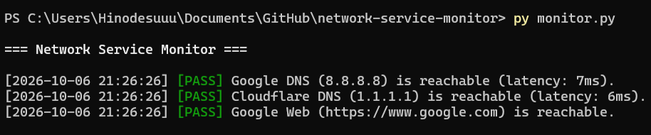
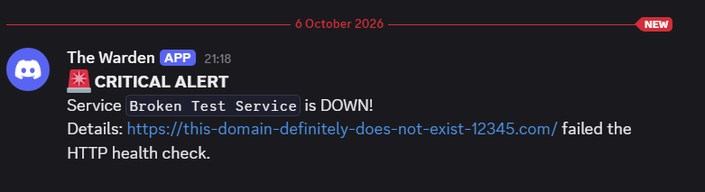

# Automated Network Infrastructure & Endpoint Health Monitor

A lightweight Python-based network monitoring utility designed to check the availability of critical network services and endpoints. The monitor performs ICMP reachability tests and HTTP health checks, reports response latency, and automatically dispatches alerts through a Discord webhook when a service becomes unavailable.

## Features

- ICMP reachability monitoring using system ping
- HTTP endpoint health checks
- Network latency reporting
- Timestamped PASS/FAIL status output
- Color-coded terminal results
- Automated Discord webhook alerts on service failure
- JSON-based target configuration
- Environment-variable protection for webhook credentials
- Cross-platform ping support for Windows, Linux, and macOS

## Tech Stack

- Python 3
- Requests
- Colorama
- python-dotenv
- JSON
- Subprocess / Networking APIs
- REST APIs
- Discord Webhooks
- Git & GitHub

## Example Output

The monitor checks each configured endpoint and reports its current status and latency.



## Automated Incident Alerts

When a monitored service becomes unreachable, the application automatically sends a critical alert through a Discord webhook.



## Project Structure

```text
network-service-monitor/
├── screenshots/
│   ├── discord-alert.png
│   └── monitor-output.png
├── .gitignore
├── monitor.py
├── requirements.txt
├── targets.json
└── README.md
```

The `.env` file containing the Discord webhook URL is intentionally excluded from version control.

## Configuration

Monitoring targets are defined inside `targets.json`.

Example:

```json
[
  {
    "name": "Google DNS",
    "type": "ping",
    "host": "8.8.8.8"
  },
  {
    "name": "Cloudflare DNS",
    "type": "ping",
    "host": "1.1.1.1"
  },
  {
    "name": "Google Web",
    "type": "http",
    "url": "https://www.google.com"
  }
]
```

Additional ICMP or HTTP targets can be added by modifying this configuration file.

## Installation

Clone the repository:

```bash
git clone https://github.com/Hinod3suuu/network-service-monitor.git
cd network-service-monitor
```

Install the required Python packages:

```bash
pip install -r requirements.txt
```

## Discord Webhook Setup

Create a `.env` file in the project directory:

```text
DISCORD_WEBHOOK_URL=your_discord_webhook_url_here
```

The `.env` file is excluded through `.gitignore` to prevent webhook credentials from being committed to the repository.

Discord alerts are optional. The network checks can still run without a configured webhook.

## Usage

Run the monitor with:

```bash
python monitor.py
```

On Windows, the Python launcher can also be used:

```powershell
py monitor.py
```

The application will check every target defined in `targets.json` and display its current status.

## Failure Detection

When a target fails a health check, the monitor:

1. Marks the target as `[FAIL]` in the terminal.
2. Records the time of the failed check.
3. Identifies the affected service or endpoint.
4. Sends an automated incident notification through the configured Discord webhook.

This provides a simple demonstration of automated network monitoring and incident alerting.

## Security

Sensitive webhook credentials are stored using environment variables rather than being hardcoded into the source code.

The `.gitignore` configuration prevents `.env` from being tracked by Git, keeping credentials out of the public repository.

## Future Improvements

Potential extensions include continuous monitoring at configurable intervals, persistent log files, response-time history, uptime statistics, retry logic, recovery notifications, and support for additional notification platforms.

## Author

**Hinod3suuu**

## License

This project is licensed under the MIT License. See the [LICENSE](LICENSE) file for details.